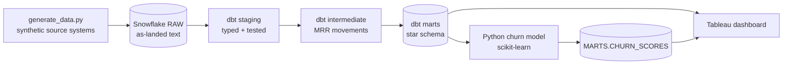

# Lumora — B2B SaaS Revenue, Retention & Customer Intelligence Platform

> End-to-end analytics project: Snowflake warehouse → dbt star schema → SaaS KPIs in SQL →
> churn prediction in Python → Tableau dashboard → business recommendations.
> **Hands-on portfolio project on synthetic data** ([provenance](docs/data_assumptions.md)).

## The business problem

Lumora, a European B2B SaaS company, grew ARR from roughly €24M to €45M in 2025.
Leadership is preparing a Series C plan and wants to know whether that growth is
**durable and efficient** — or whether a leaky customer base is being masked by
acquisition spend.

## Business questions

1. **Growth quality:** How much of ARR growth comes from new logos vs. expansion, and how much is lost to contraction and churn?
2. **Retention:** Why is net revenue retention below 100%? Which segments, plans and channels leak the most revenue?
3. **Acquisition efficiency:** Which channels produce customers with the best LTV:CAC and payback — not just the cheapest CAC?
4. **Churn risk:** Which product-usage signals predict churn 90 days ahead, and which accounts should Customer Success prioritise this month?
5. **Cohorts:** Is retention improving for newer signup cohorts, by segment?
6. **Forecast:** What does ARR look like in 12 months under base, upside and downside scenarios?
7. **Collections:** How much churn is involuntary (failed payments) and therefore recoverable?

## Architecture



- **Data model:** [star schema & fact grains](docs/star_schema.md)
- **Metric definitions:** [SaaS KPI dictionary](docs/kpi_dictionary.md)

## Stack
Snowflake · dbt Core · SQL · Python (pandas, scikit-learn) · Tableau · Git/GitHub

## Repository structure
```
├── data/raw/              # generated CSVs (git-ignored; reproducible)
├── docs/                  # KPI dictionary, star schema, data assumptions
├── scripts/
│   ├── generate_data.py   # synthetic SaaS source systems (seed 42)
│   └── load_to_snowflake.py
├── snowflake/01_setup.sql # warehouse, database, schemas, cost guardrail
└── (Day 2+) dbt/, notebooks/, dashboard/
```

## Reproduce
```bash
python -m venv .venv && source .venv/bin/activate
pip install -r requirements.txt
python scripts/generate_data.py                  # writes data/raw/*.csv
# run snowflake/01_setup.sql in a Snowsight worksheet, then:
cp .env.example .env   # fill in your account details
set -a; source .env; set +a
python scripts/load_to_snowflake.py
# no local Python? upload data/raw/*.csv to a stage and run snowflake/02_load_from_stage.sql
```

## Progress
- [x] Day 1 — business questions, KPI dictionary, star schema, synthetic data, raw load to Snowflake
- [ ] Day 2 — dbt project: sources, staging models, tests
- [ ] Day 3 — intermediate MRR movements, marts, SaaS KPI SQL
- [ ] Day 4 — churn model (scikit-learn), cohort analysis, ARR scenarios
- [ ] Day 5 — Tableau dashboard, recommendations, final README

## Findings
_To be completed on Day 5: three to five decisions leadership should take, with evidence._
