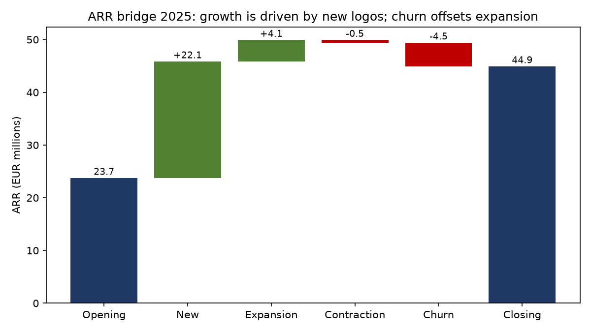
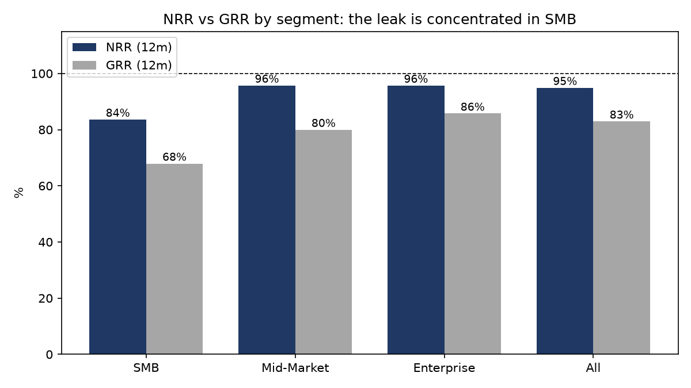
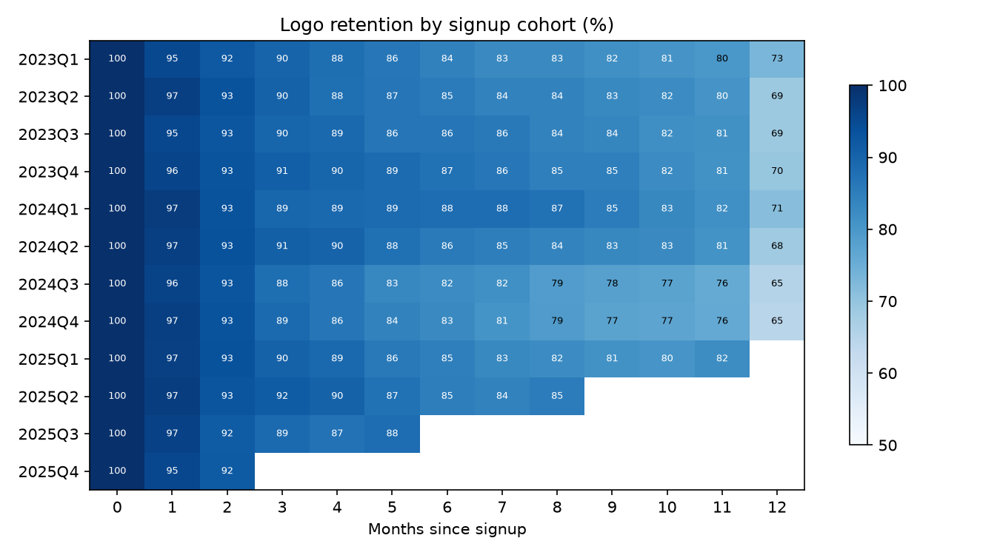
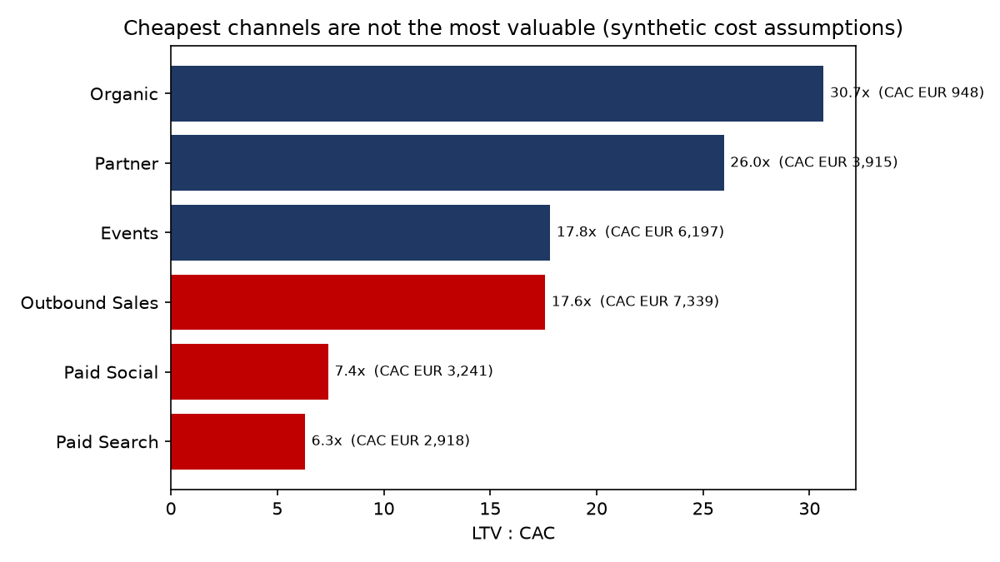
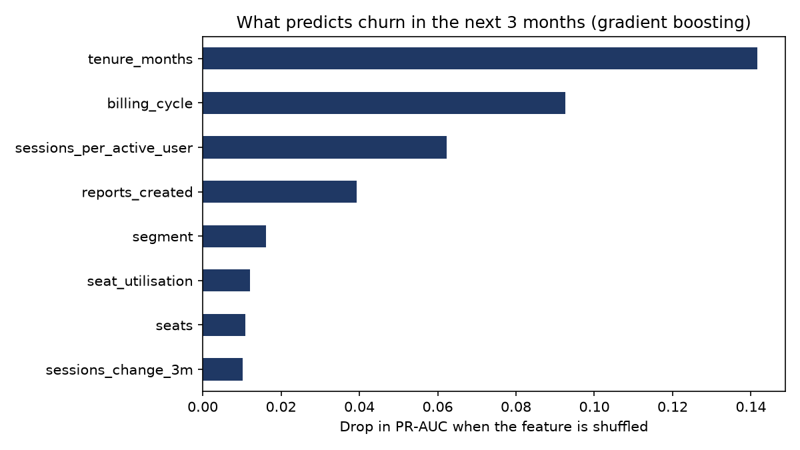
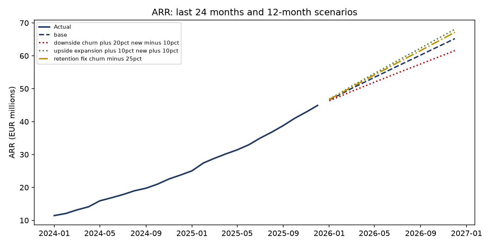
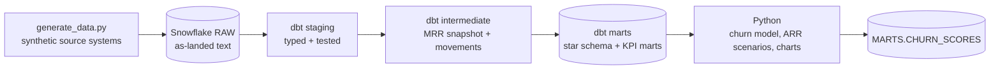

# Lumora — B2B SaaS Revenue, Retention & Customer Intelligence Platform

> End-to-end analytics project: Snowflake warehouse → dbt star schema with 94 tests → SaaS KPIs in SQL →
> churn prediction and ARR scenarios in Python → business recommendations.
> **Hands-on portfolio project on synthetic data** ([provenance](docs/data_assumptions.md)), not production experience.

## The business problem

Lumora, a European B2B SaaS company, grew ARR from €23.7M to €44.9M in 2025. Leadership wants to know
whether that growth is **durable and efficient**, or whether a leaky customer base is being masked by acquisition.

## Key findings

**1. Growth is acquisition-driven; churn cancels out expansion.** In 2025, new customers added €22.1M of ARR.
Expansion added €4.1M, but churn removed €4.5M and contraction another €0.5M.



**2. NRR of 95% hides a GRR of 83%, and the leak is concentrated in SMB.** SMB customers keep only 68% of their
revenue after 12 months (GRR), against 86% for Enterprise.



**3. There is a renewal cliff at month 12.** Cohort retention declines gradually, then drops sharply when annual
contracts come up for renewal. About 69% of customers remain after 12 months and 53% after 24.



**4. The cheapest channels are not the most valuable.** Paid Search and Paid Social have low acquisition costs but
the weakest LTV:CAC, because those customers spend less and churn faster. Partner and Organic customers are the most
valuable. *Absolute LTV:CAC values are inflated by the synthetic cost assumptions; the ranking between channels is
the meaningful result.*



**5. Churn is predictable three months ahead.** A gradient-boosting model (time-based split: trained on 2023–24,
tested on 2025) reaches ROC-AUC ≈ 0.81. Contacting the riskiest 10% of customers would reach ≈ 38% of those who
go on to churn, about four times better than random. The strongest signals are tenure (renewal timing), billing
cycle, and usage depth (sessions per active user, reports created).



**6. A retention fix is worth almost as much as faster growth, without extra spend.** Starting from €44.9M, the
base scenario reaches ≈ €65M ARR by December 2026. Cutting churn by 25% adds ≈ €1.9M on top; growing new and
expansion ARR by 10% adds ≈ €2.9M, but would need more acquisition budget.



## Recommendations

1. **Fix SMB retention before scaling SMB acquisition.** Introduce usage-based onboarding and Customer Success
   triggers in the first 90 days, when usage depth predicts churn best.
2. **Work the renewal pipeline 60–90 days ahead.** Use the churn scores (`MARTS.CHURN_SCORES`) to prioritise
   annual renewals by risk and MRR.
3. **Rebalance acquisition spend toward Partner and Organic,** after validating the real cost allocation per
   channel (in particular sales costs, which drive CAC for Outbound and Events).
4. **Report NRR and GRR together** in every leadership pack, by segment, so expansion cannot hide leakage.

## Architecture



| Layer | Models |
|---|---|
| Staging | 8 typed models, one per source table |
| Intermediate | `int_month_spine`, `int_customer_mrr_monthly`, `int_mrr_movements` |
| Marts | `dim_customer`, `dim_plan`, `dim_sales_rep`, `fct_mrr_monthly`, `mart_arr_bridge`, `mart_retention`, `mart_cohort_retention`, `mart_unit_economics`, `mart_churn_features` |

**94 dbt tests**, including three reconciliation tests: MRR movements sum to the change in total MRR; the ARR
bridge balances every month (opening + new + expansion − contraction − churn = closing); and each month's opening
ARR equals the previous month's closing.

- **Data model:** [star schema & fact grains](docs/star_schema.md)
- **Metric definitions:** [SaaS KPI dictionary](docs/kpi_dictionary.md)
- **Lineage:** run `dbt docs generate && dbt docs serve` in `dbt/`

## Stack
Snowflake · dbt Core (dbt_utils) · SQL · Python (pandas, scikit-learn, matplotlib) · Git/GitHub (PR workflow) · AI-assisted development (Claude)

## Reproduce
```bash
pip install -r requirements.txt dbt-snowflake
python scripts/generate_data.py                  # synthetic source data (seed 42)
# load: run snowflake/01_setup.sql, then snowflake/02_load_from_stage.sql
cd dbt && dbt deps && dbt build && cd ..         # 94 tests
python python/churn_model.py                     # metrics + scores written to MARTS.CHURN_SCORES
python python/arr_forecast.py                    # 12-month scenarios
python python/make_charts.py                     # charts in docs/images/
```
Snowflake access uses key-pair authentication configured in `~/.dbt/profiles.yml` (not in this repo).

## Limitations
- Synthetic data with stylised behaviour: the project demonstrates method, not real SaaS benchmarks.
- LTV uses a stated 78% gross margin and a 60-month lifetime cap; synthetic CAC is low relative to ARPA.
- The churn model is predictive, not causal: features flag who to contact, not why customers leave.
- The forecast is a run-rate scenario model, not a statistical forecast with confidence intervals.
