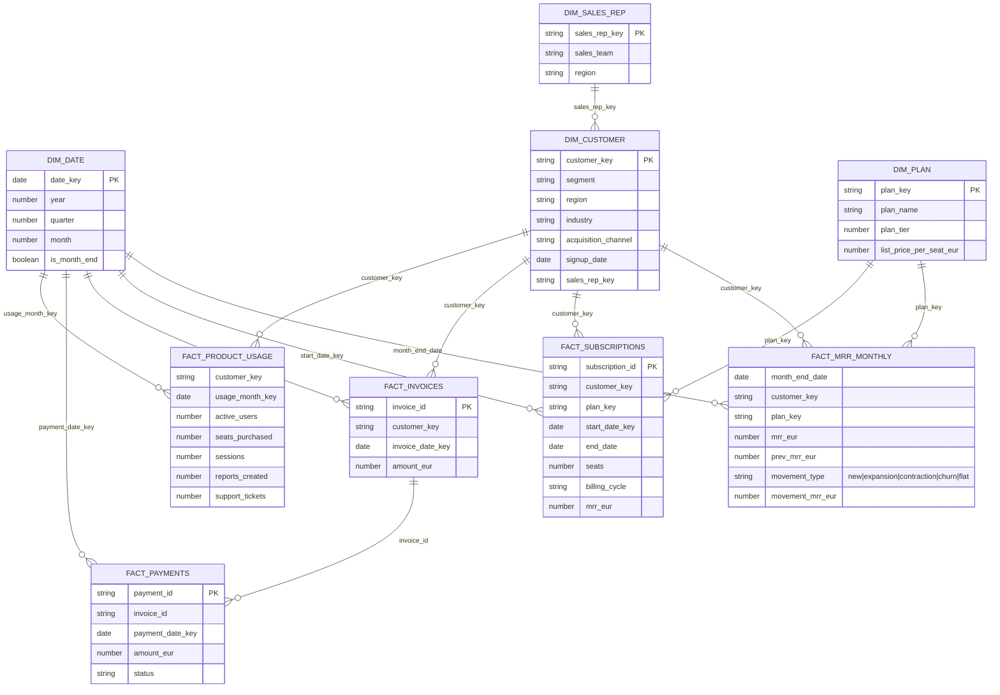

# Star Schema — LUMORA.MARTS

## Fact grains (state these in interviews)

| Fact | Grain | Why it exists |
|---|---|---|
| `fact_mrr_monthly` | one row per customer per month-end | **The core analytical fact.** Periodic snapshot that makes MRR movements, NRR/GRR and cohorts simple, fast SQL. Derived from subscriptions in the intermediate layer. |
| `fact_subscriptions` | one row per subscription version (a plan/seat change closes a row and opens a new one) | Type-2-style history of contracts; source for the snapshot |
| `fact_invoices` | one row per invoice | Billing view (annual contracts invoice 12 months upfront — differs from MRR) |
| `fact_payments` | one row per payment attempt | Collections, failure rate, involuntary churn |
| `fact_product_usage` | one row per customer per month | Product health, churn-model features |

**Design decisions**
- `dim_customer` is SCD Type 1 (current attributes). Segment does not change in this dataset; in production, segment changes would justify Type 2.
- Acquisition channel lives in `dim_customer` rather than a separate dimension: it is a fixed attribute of the customer, and a 6-row dimension adds joins without adding value.
- Snowflake keys are the natural IDs (e.g. `CUST_00001`); surrogate keys via `dbt_utils.generate_surrogate_key` are added in Day 2 marts.
